Link del video: https://youtu.be/5hPJnAUr2lQ

El propósito de este laboratorio es monitorear un router y un switch Cisco por SNMP desde un servidor Zabbix, con DHCP en la LAN. Y ver como funciona un servidor SNMP.

---

## Topología

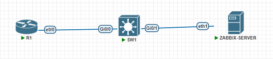

---

## Versiones de los dispositivos

| Dispositivo | Imagen / Versión | Rol |
|-------------|------------------|-----|
| Router | Cisco IOL (versión: 15.7) | Gateway, servidor DHCP, agente SNMP |
| Switch | Cisco vIOS-L2 (versión: 15.2 | Agente SNMP |
| Servidor Zabbix | Ubuntu 20.04 (`pnetlab/ubuntu_sv`), Zabbix 6.0.49, MySQL 8.0, Apache 2.4.41, PHP 7.4 | Servidor de monitoreo |

---

## Direccionamiento VLSM

Matricula: 2025-1410

Red base: `14.10.0.0/16` (últimos 4 dígitos de la matrícula)

| # | Segmento | Red | Máscara | Prefijo | Hosts | Rango útil | Broadcast |
|---|----------|-----|---------|---------|-------|------------|-----------|
| 1 | LAN | 14.10.10.0 | 255.255.255.240 | /28 | 14 | 14.10.10.1 - 14.10.10.14 | 14.10.10.15 |

### Asignación de IPs

| Dispositivo | Interfaz | IP | Gateway |
|-------------|----------|----|---------|
| Router (R1) | e0/0 | 14.10.10.1/28 (estática) | - |
| Switch (SW1) | Vlan1 | 14.10.10.2/28 (estática) | 14.10.10.1 |
| Servidor Zabbix | eth1 | DHCP (pool 14.10.10.5 - 14.10.10.14) | 14.10.10.1 |

---

## DHCP

### Servidor Zabbix como cliente DHCP

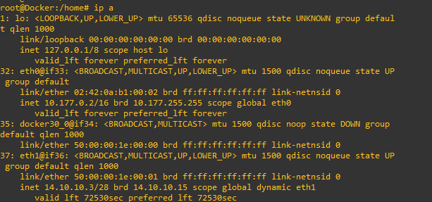

---

## Configuración en Zabbix

### Servidor Zabbix

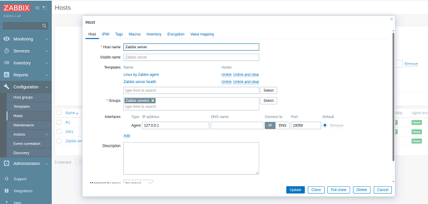

### Router (R1)

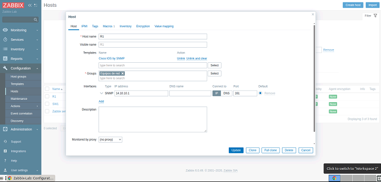

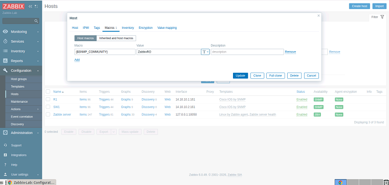

### Switch (SW1)

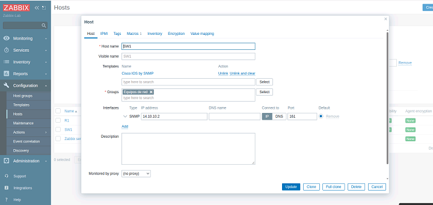

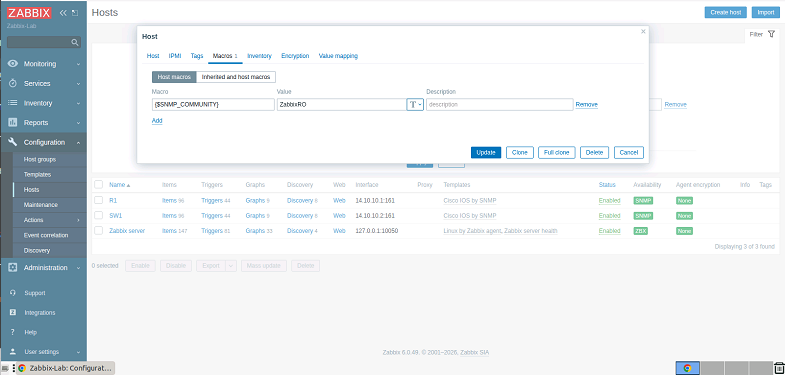

---

## Verificación de los datos SNMP en Zabbix

### Hosts en Zabbix

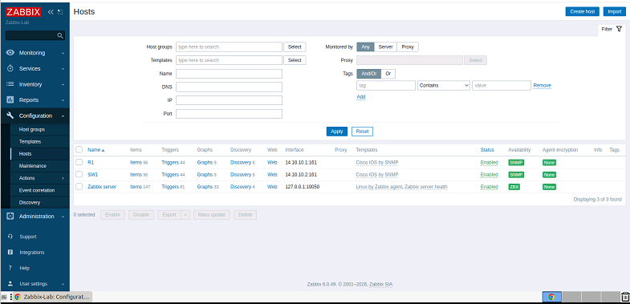

### Latest data

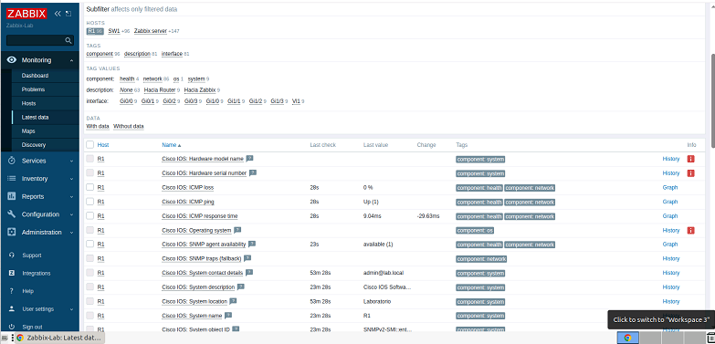

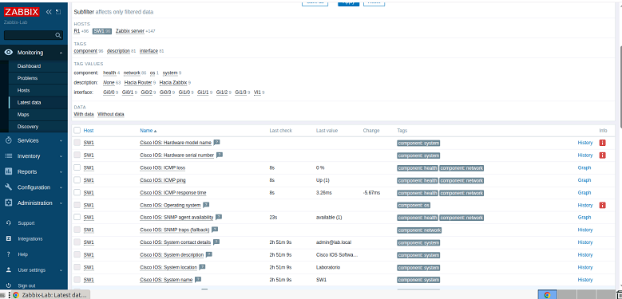

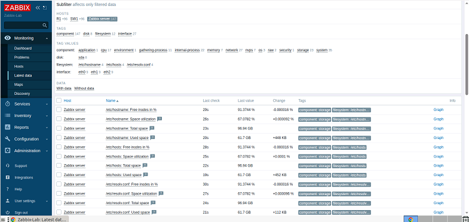

---

